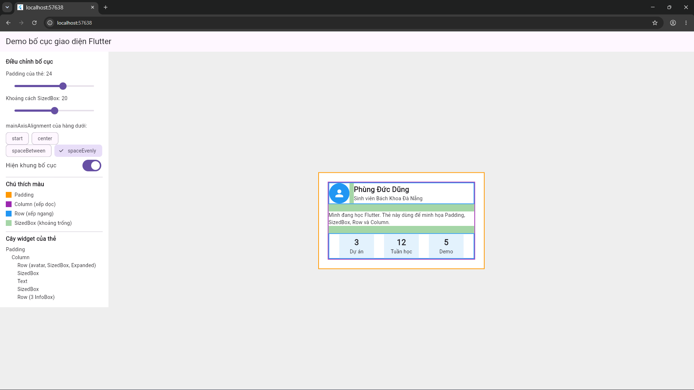
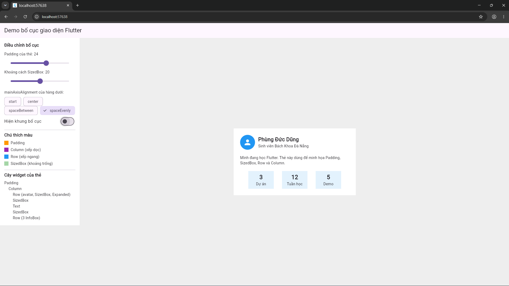

# layout-demo

Demo Flutter web minh họa **cơ sở thiết kế bố cục giao diện**, thuộc môn **Lập trình Đa nền tảng** (Báo cáo Tuần, Chủ đề 1: Cơ sở thiết kế bố cục giao diện trong Flutter).

- Trường Đại học Bách Khoa, Khoa Điện tử và Trí tuệ nhân tạo
- Nhóm thực hiện: Phùng Đức Dũng, Phan Văn Đức Hiếu

## 1. Mô tả dự án

Ứng dụng có một màn hình gồm **thẻ hồ sơ** (avatar, tên, giới thiệu, 3 ô thông tin) và **bảng điều chỉnh bố cục** bên cạnh. Người dùng kéo thanh trượt hoặc chọn nút thì thẻ đổi bố cục ngay, nên nhìn thấy trực tiếp tác dụng của từng widget.

Mục tiêu theo yêu cầu bài tập:

- Thiết kế một giao diện tự chọn (thẻ hồ sơ) bằng các widget bố cục phù hợp.
- Giải thích cấu trúc widget: có công tắc **Hiện khung bố cục** tô màu từng loại widget, kèm chú thích màu và cây widget.
- Minh họa cách điều chỉnh bố cục: thanh trượt Padding, thanh trượt SizedBox, nút chọn `mainAxisAlignment`.

### Widget sử dụng

| Widget | Vai trò trong demo |
|---|---|
| `StatelessWidget` | `ProfileCard`, `InfoBox`, `LayoutFrame`, `SpaceBox`: giao diện chỉ phụ thuộc dữ liệu truyền vào |
| `StatefulWidget` | `HomeScreen`: giữ `padding`, `gap`, `alignIndex`, `showFrame`, gọi `setState` khi người dùng chỉnh |
| `Container` | Nền trắng của thẻ, avatar tròn, nền ô `InfoBox` |
| `Padding` | Khoảng cách giữa viền thẻ và nội dung |
| `SizedBox` | Khoảng trống giữa các phần của thẻ |
| `Row` | Hàng avatar và tên, hàng 3 ô thông tin, bố cục chung của màn hình |
| `Column` | Nội dung thẻ xếp dọc, bảng điều chỉnh xếp dọc |
| `Expanded` | Phần tên chiếm chỗ còn lại cạnh avatar, vùng thẻ chiếm chỗ còn lại cạnh bảng |

### Công nghệ

| Công nghệ | Vai trò |
|---|---|
| Flutter web (chạy trên Chrome) | Xây dựng giao diện |
| Material (`material.dart`) | Các widget có sẵn: Scaffold, Slider, ChoiceChip, SwitchListTile |

Demo không dùng package ngoài.

## 2. Cấu trúc chương trình

```
lib/
├── main.dart
├── home_screen.dart
├── profile_card.dart
├── info_box.dart
└── layout_frame.dart
```

| File | Lớp | Loại | Nhiệm vụ |
|---|---|---|---|
| `main.dart` | `MyApp` | Stateless | Khởi động app, mở `HomeScreen` |
| `home_screen.dart` | `HomeScreen` | Stateful | Giữ state, vẽ bảng điều chỉnh, truyền giá trị cho `ProfileCard` |
| `profile_card.dart` | `ProfileCard` | Stateless | Thẻ hồ sơ: Padding, Column, Row, SizedBox, Expanded |
| `info_box.dart` | `InfoBox` | Stateless | Ô thông tin, viết một lần và dùng lại 3 lần |
| `layout_frame.dart` | `LayoutFrame`, `SpaceBox` | Stateless | Vẽ khung màu quanh widget và tô màu SizedBox để nhìn thấy bố cục |

Cây widget của thẻ:

```
Padding
  └── Column
        ├── Row (avatar, SizedBox, Expanded)
        ├── SizedBox
        ├── Text
        ├── SizedBox
        └── Row (3 InfoBox)
```

## 3. Hướng dẫn cài đặt và chạy

### Yêu cầu

- [Flutter SDK](https://docs.flutter.dev/get-started/install) đã cài và chạy được lệnh `flutter doctor`
- Trình duyệt Google Chrome

### Các bước

Nếu đã có repo của nhóm:

```bash
git clone <đường-dẫn-repo-của-nhóm>
cd <tên-thư-mục-repo>
flutter pub get
flutter run -d chrome
```

Nếu chỉ có thư mục `lib`, tạo project mới rồi chép vào:

```bash
flutter create layout_demo --platforms=web
cd layout_demo
```

Xóa thư mục `lib` cũ, chép thư mục `lib` của demo vào, rồi chạy:

```bash
flutter run -d chrome
```

### Cách demo

1. Mở app: thẻ hồ sơ hiện ở giữa, khung bố cục đang bật.
2. Nhìn chú thích màu: cam là Padding, tím là Column, xanh dương là Row, xanh lá là SizedBox.
3. Kéo **Padding của thẻ** từ 0 đến 40: lề quanh nội dung tăng dần, khung cam giữ nguyên còn khung tím co vào.
4. Kéo **Khoảng cách SizedBox**: các dải xanh lá giữa các phần dày lên hoặc mỏng đi.
5. Chọn lần lượt `start`, `center`, `spaceBetween`, `spaceEvenly`: ba ô ở hàng dưới đổi vị trí theo trục chính.
6. Tắt **Hiện khung bố cục** để xem giao diện thật.

## 4. Phân công công việc

| Thành viên | Phần việc |
|---|---|
| **Phùng Đức Dũng** | Thiết kế thẻ hồ sơ: `profile_card.dart`, `info_box.dart`. Chọn widget bố cục phù hợp (Padding, Column, Row, SizedBox, Expanded). Phần lý thuyết: widget tree, Container, Padding, SizedBox, Row và Column |
| **Phan Văn Đức Hiếu** | Bảng điều chỉnh và state: `main.dart`, `home_screen.dart`, `layout_frame.dart`. Thanh trượt, nút chọn căn chỉnh, khung màu, chú thích. Phần lý thuyết: StatelessWidget, StatefulWidget, constraints, khoảng cách, căn chỉnh, tái sử dụng |
| **Cả hai** | Cấu trúc thư mục, chạy thử và chụp ảnh kết quả, làm slide thuyết trình, viết README, đẩy code lên GitHub |


## 5. Kết quả dự án

Đối chiếu với yêu cầu của bài tập:

| Yêu cầu | Kết quả |
|---|---|
| Thiết kế giao diện tự chọn bằng widget bố cục phù hợp | Thẻ hồ sơ dùng Container, Padding, SizedBox, Row, Column, Expanded |
| Dùng StatelessWidget và StatefulWidget | 4 widget Stateless, `HomeScreen` là Stateful dùng `setState` |
| Khoảng cách, căn chỉnh | Thanh trượt Padding và SizedBox, nút chọn `mainAxisAlignment` |
| Khả năng tái sử dụng widget | `InfoBox` viết một lần, dùng 3 lần |
| Giải thích cấu trúc widget | Khung màu theo loại widget, chú thích màu, cây widget trong bảng điều chỉnh |
| Minh họa cách điều chỉnh bố cục | Chỉnh giá trị thì thẻ đổi ngay trên màn hình |

### Ảnh chụp màn hình


| Bật khung bố cục | Tắt khung bố cục | 
|---|---|
|  |  |

### Điều rút ra

- Giao diện là cây widget, mỗi widget chỉ làm một việc nên dễ đổi từng phần.
- Đổi một giá trị (Padding, SizedBox, `mainAxisAlignment`) là đổi được bố cục mà không sửa các widget khác.
- Tách `InfoBox` thành widget riêng giúp code ngắn và sửa một nơi là đổi cả ba ô.

### Hạn chế và hướng phát triển

- Demo mới có một màn hình, chưa thích ứng với màn hình nhỏ (điện thoại).
- Có thể thêm `Flexible`, `Align`, `Stack` để minh họa thêm bố cục.
- Có thể cho nhập tên và thông tin thẻ để người dùng tự thiết kế thẻ.

## 6. Tài liệu tham khảo

- [Flutter - Layouts in Flutter](https://docs.flutter.dev/ui/layout)
- [Flutter - Understanding constraints](https://docs.flutter.dev/ui/layout/constraints)
- [Flutter - Architectural overview](https://docs.flutter.dev/resources/architectural-overview)
- [Flutter - Building a layout](https://docs.flutter.dev/ui/layout/tutorial)
- [Flutter - Widgets catalog](https://docs.flutter.dev/ui/widgets)